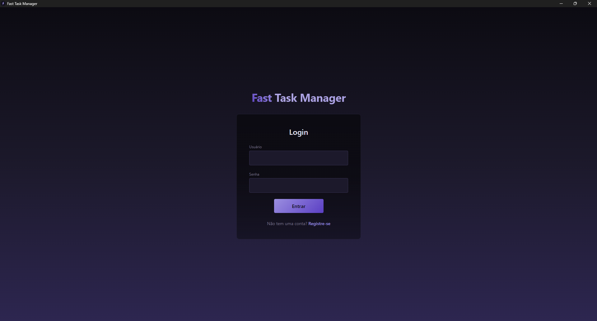
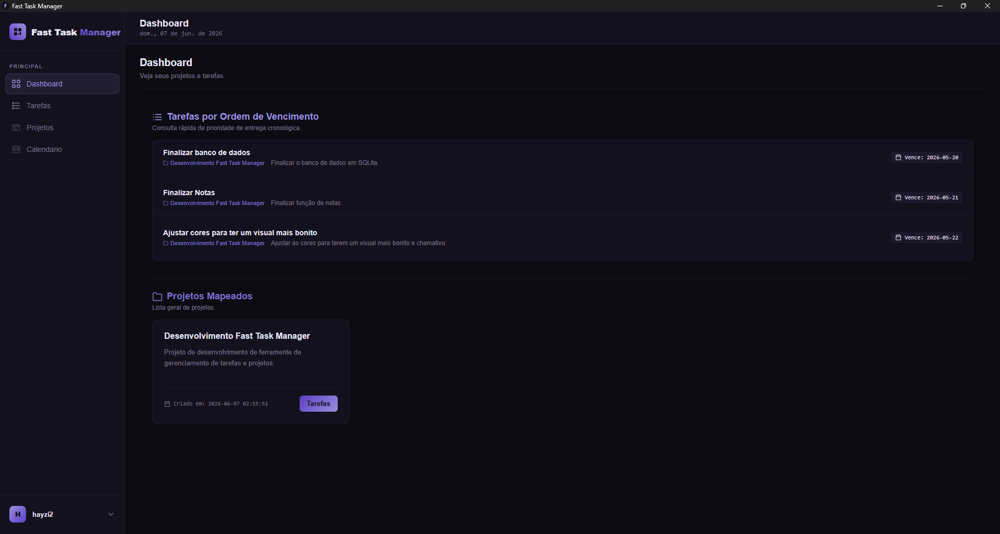
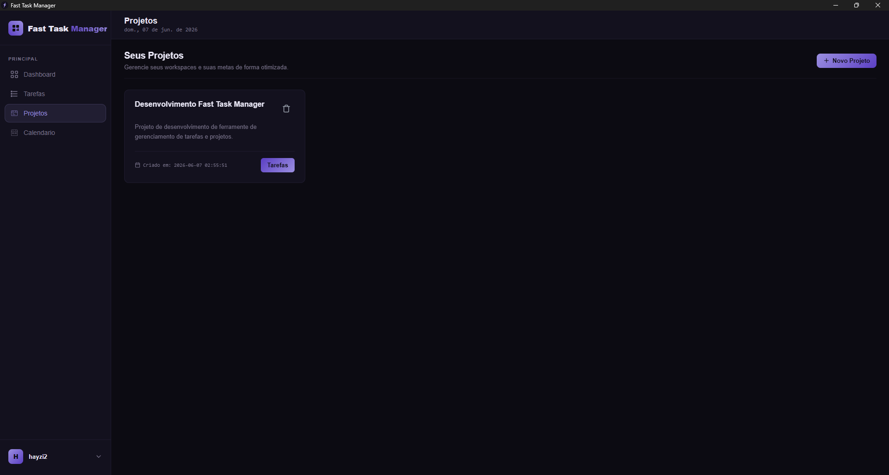
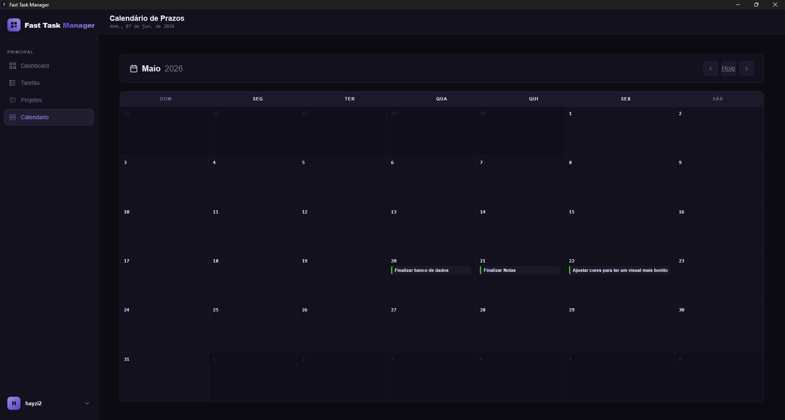

# Fast Task Manager

O Fast Task Manager é uma ferramenta de produtividade pessoal desenvolvida para organização de projetos, tarefas e anotações. Com uma interface inspirada no design minimalista de ferramentas como o Notion e Trello, o foco é a funcionalidade e o acesso rápido a informações críticas.
O projeto foi construído utilizando uma arquitetura moderna e leve como uma aplicação Web completa.

## Screenshots






# Tecnologias Utilizadas
- **Backend:** Python com FastAPI e Uvicorn
- **Banco de Dados:** SQLite
- **UI/UX:** HTML5 (Jinja2 Templates), CSS3 Modular, JavaScript
- **Integração Web & Exportação:** `urllib.request` (importação de Issues do GitHub) e `zipfile` + `json` (exportação compactada de dados)

# Objetivo do Projeto

Este software nasceu para ser um gerenciador de tarefas pessoal, funcional e ágil. A ausência de camadas desnecessárias de colaboração complexa garante que o sistema seja focado na organização do próprio usuário, oferecendo gestão de projetos, tarefas com prazos, bloco de notas rico (com exportação TXT e PDF), calendário mensal, relatórios de produtividade e sincronização/backup de dados.

# Como rodar o código

## 1. Pré-requisitos
- Ter o Python 3.x instalado.

## 2. Configuração do ambiente virtual
```bash
python -m venv venv
venv\Scripts\activate.bat   # Windows
source venv/bin/activate    # Linux/macOS

pip install -r requirements.txt
```

## 3. Iniciando o servidor
### Para rodar a aplicação:
```bash
python main.py
```
Ou com recarregamento automático (reload):
```bash
uvicorn main:app --reload
```
O servidor estará acessível no navegador em `http://127.0.0.1:8000`.

# Estrutura do Projeto

```text
Fast-Task-Manager/
|---- routers/
|     |---- auth.py
|     |---- data_transfer.py
|     |---- notes.py
|     |---- projects.py
|     |---- tasks.py
|     |---- views.py
|---- static/
|     |---- css/
|     |     |---- about.css
|     |     |---- base.css
|     |     |---- calendar.css
|     |     |---- dashboard.css
|     |     |---- data_transfer.css
|     |     |---- notes.css
|     |     |---- project_tasks.css
|     |     |---- projects.css
|     |     |---- reports.css
|     |     |---- sign_in.css
|     |     |---- sign_up.css
|     |     |---- tasks.css
|     |---- image/
|     |---- js/
|     |     |---- auth.js
|     |     |---- notes.js
|     |     |---- projects.js
|     |     |---- script.js
|     |     |---- tasks.js
|     |---- favicon.ico
|---- templates/
|     |---- about.html
|     |---- base.html
|     |---- calendar.html
|     |---- dashboard.html
|     |---- data_transfer.html
|     |---- notes.html
|     |---- project_tasks.html
|     |---- projects.html
|     |---- reports.html
|     |---- sign_in.html
|     |---- sign_up.html
|     |---- tasks.html
|---- database.py
|---- main.py
|---- README.md
|---- requirements.txt
|---- .gitignore
```
